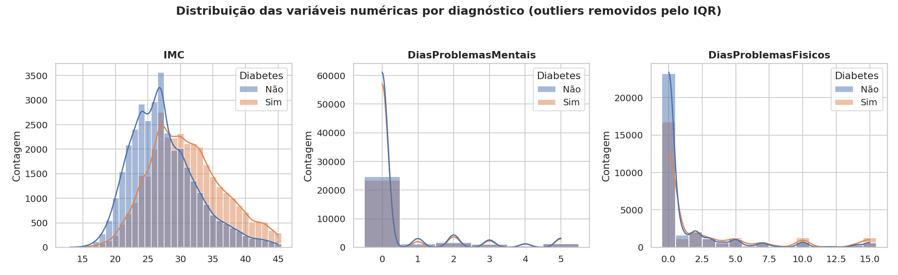
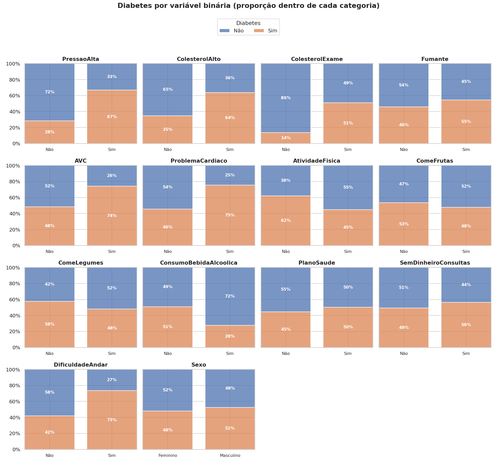
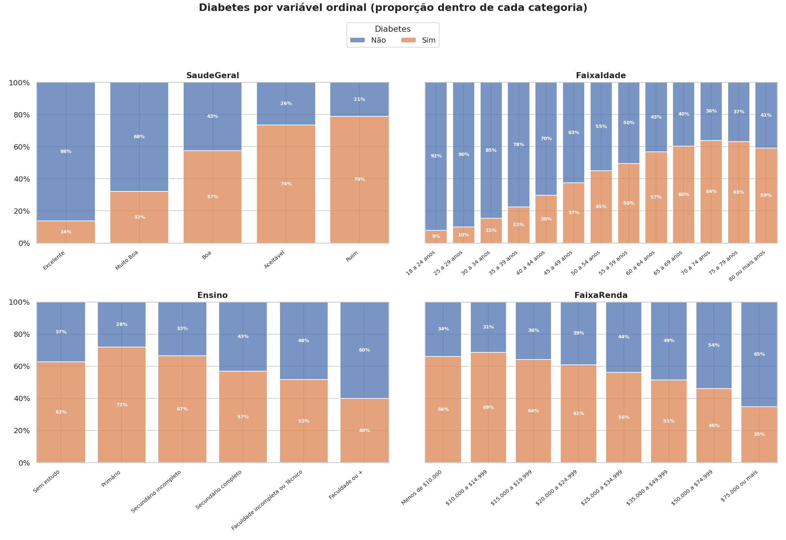
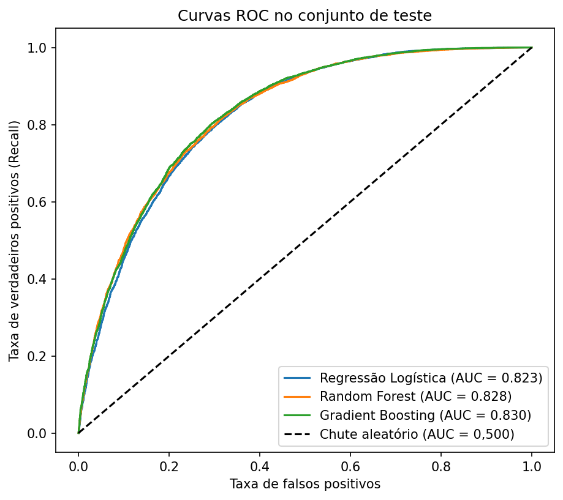
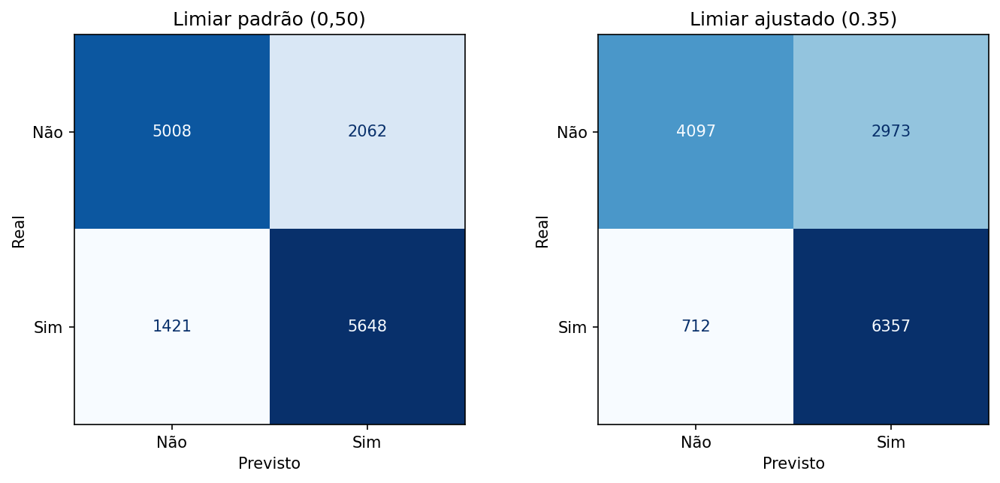
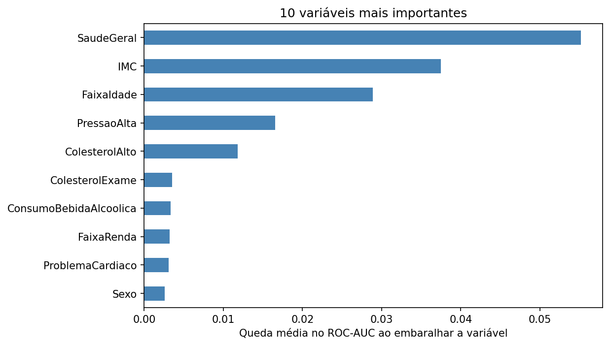

# 🩺 Fatores de Risco para Diabetes: Análise Exploratória e Modelagem Preditiva (BRFSS 2015)


Análise estatística de indicadores de saúde e modelo de classificação para triagem de risco de diabetes, construídos sobre 70.692 respostas da pesquisa BRFSS 2015 do CDC (EUA).

## 📑 Índice

- [Sobre o projeto](#-sobre-o-projeto)
- [Dados](#-dados)
- [Principais resultados](#-principais-resultados)
- [Visualizações](#-visualizações)
- [Estrutura do projeto](#%EF%B8%8F-estrutura-do-projeto)
- [Tecnologias](#%EF%B8%8F-tecnologias)
- [Como executar](#-como-executar)
- [Limitações](#%EF%B8%8F-limitações)
- [Próximos passos](#%EF%B8%8F-próximos-passos)
- [Licença](#-licença)
- [Créditos](#-créditos)
- [Autor](#-autor)

---

## 📌 Sobre o projeto

O diabetes é uma das doenças crônicas mais prevalentes no mundo e representa um desafio significativo para sistemas de saúde pública. A identificação precoce de fatores clínicos e socioeconômicos associados à condição permite direcionar políticas preventivas e triagens mais eficientes.

Este projeto percorre o fluxo completo de uma análise de dados: **tratamento e otimização de memória, análise exploratória, testes de hipótese e modelagem preditiva**. A base é balanceada, com 35.346 registros em cada classe.

**Perguntas norteadoras:**
1. Como otimizar o armazenamento e a tipagem de uma base de saúde com dezenas de milhares de registros para análises ágeis?
2. Existem diferenças estatisticamente significativas nos indicadores numéricos (como o IMC) entre pessoas com e sem diabetes?
3. Quais comorbidades e fatores socioeconômicos apresentam maior associação, visual e estatística, com o diagnóstico?
4. Com que desempenho é possível prever o diagnóstico a partir desses indicadores, priorizando a detecção dos casos em risco?

---

## 💾 Dados

- **Fonte:** [Diabetes Health Indicators Dataset](https://www.kaggle.com/datasets/alexteboul/diabetes-health-indicators-dataset), de Alex Teboul no Kaggle, preparado a partir do BRFSS 2015 (*Behavioral Risk Factor Surveillance System*), pesquisa telefônica anual de saúde do CDC.
- **Arquivo usado:** `diabetes_binary_5050split_health_indicators_BRFSS2015.csv`, com **70.692 registros e 22 colunas**, compactado em `dados/diabetes.zip`.
- **Variável alvo (`Diabetes`):** segundo a fonte, `Sim` agrupa pessoas com **pré-diabetes ou diabetes**. A base tem 50% de cada classe, por construção.
- **Dicionário de variáveis:** [`referencias/01_dicionario_de_dados.md`](referencias/01_dicionario_de_dados.md).

---

## 🔍 Principais resultados

### 1. Otimização de Dados e Performance
* **Redução de ~87% no uso de memória:** por meio da conversão estratégica de tipos (*downcasting* das variáveis numéricas para `int8` e tipagem de 15 variáveis binárias e 4 ordinais para `category`), o consumo de RAM do DataFrame caiu de **11,9 MB para 1,5 MB**.
* **Persistência em Parquet:** a base tratada e traduzida para o português foi exportada em formato `.parquet`, preservando os metadados de tipagem e acelerando o carregamento nas etapas seguintes.

### 2. Achados Estatísticos (Variáveis Numéricas)
* **Distribuições assimétricas à direita:** `IMC`, `DiasProblemasMentais` e `DiasProblemasFisicos` têm assimetria positiva nos dois grupos. O teste de **Kolmogorov-Smirnov**, aplicado ao `IMC`, rejeitou a normalidade com e sem *outliers*. Como a amostra é grande (cerca de 35 mil registros por grupo), o teste rejeita até desvios pequenos, por isso a decisão também considerou assimetria, curtose e gráficos. Isso justifica o uso de um teste não paramétrico.
* **Tratamento de outliers via IQR:** o método do boxplot removeu 3,1% dos registros de `IMC` (máximo de 98 para 45), mas 16,7% e 15,0% dos registros de `DiasProblemasMentais` e `DiasProblemasFisicos`, pois a maior parte dos valores é 0 e o intervalo interquartil é estreito. Por isso a remoção foi usada para verificar a robustez dos testes, e não para substituir a base original.
* **Diferença significativa no IMC:** o `IMC` médio é de cerca de 31,9 no grupo com diabetes contra 27,8 no grupo sem diabetes. Os testes de **Levene** (variância), ***t* de Welch** e **Mann-Whitney** confirmaram diferença estatisticamente significativa ($p < 0,05$) entre os grupos, tanto com quanto sem *outliers*.

### 3. Fatores Clínicos e Socioeconômicos (Variáveis Binárias e Ordinais)

> **Atenção ao interpretar os percentuais:** a base é balanceada (50% com diabetes). Os percentuais abaixo mostram a proporção de pessoas com diabetes dentro de cada grupo **nesta amostra**, e não a prevalência real na população.

* **Associação significativa em todas as variáveis:** o teste **qui-quadrado de independência** rejeitou a independência entre `Diabetes` e as 17 variáveis categóricas (o maior p-valor, cerca de $8 \times 10^{-10}$, é o de `PlanoSaude`). As maiores estatísticas foram as de `SaudeGeral` (≈ 12.304) e `PressaoAlta` (≈ 10.288), e a menor foi a de `PlanoSaude` (≈ 37,8).
* **Comorbidades associadas:** a proporção de pessoas com diabetes é bem maior entre quem tem **pressão alta** (66,8% contra 28,3%), **colesterol alto** (63,7% contra 34,8%), **problema cardíaco** (75,4% contra 45,6%) e **dificuldade para andar** (73,4% contra 42,1%). A **atividade física** aparece como fator inverso (44,8% entre quem pratica contra 62,2% entre quem não pratica).
* **Correlação de Spearman com o diagnóstico:** `PressaoAlta` (≈ 0,38), `ColesterolAlto` (≈ 0,29) e `ProblemaCardiaco` (≈ 0,21) têm correlação positiva, e `AtividadeFisica` negativa (≈ -0,16).
* **Autoavaliação e demografia:**
  * `SaudeGeral`: a proporção cresce em todos os níveis, de 13,8% ("Excelente") a 78,8% ("Ruim").
  * `FaixaIdade`: cresce de 8,0% (18 a 24 anos) até 63,9% (70 a 74 anos) e recua levemente nas faixas seguintes (59,1% em "80 ou mais").
  * `Ensino` e `FaixaRenda`: caem conforme o nível aumenta, de 71,8% (ensino primário) a 40,0% (faculdade ou +) e de 68,6% (renda de $10.000 a $14.999) a 34,8% (renda de $75.000 ou mais).

### 4. Modelagem Preditiva (notebook 04)

Três modelos foram comparados por validação cruzada estratificada (5 partições) no conjunto de treino (80%), e o escolhido foi avaliado uma única vez no conjunto de teste (20%).

| Modelo | ROC-AUC | Recall | Precisão | F1 |
| :--- | :---: | :---: | :---: | :---: |
| Gradient Boosting | **0,830** | 0,798 | 0,731 | 0,763 |
| Random Forest | 0,827 | 0,794 | 0,730 | 0,761 |
| Regressão Logística | 0,825 | 0,768 | 0,739 | 0,753 |

*Médias da validação cruzada, com limiar de decisão 0,50.*

* **Modelo escolhido:** Gradient Boosting (`HistGradientBoostingClassifier`), com **ROC-AUC de 0,830 no teste**. Os três modelos ficam muito próximos, e a regressão logística, bem mais simples, chega perto.
* **Ajuste do limiar para triagem:** o limiar foi escolhido no treino (previsões fora da amostra) como o maior que garante Recall de pelo menos 90%. No teste, mudar o limiar de 0,50 para 0,35 elevou o **Recall de 79,9% para 89,9%**, com a Precisão indo de 73,3% para 68,1%.
* **Variáveis mais importantes** (importância por permutação): `SaudeGeral`, `IMC`, `FaixaIdade`, `PressaoAlta` e `ColesterolAlto`, coerente com a análise exploratória.

---

## 📊 Visualizações

### Distribuição das Variáveis Numéricas (pós-tratamento de outliers)


### Comparativo de Indicadores Binários por Diagnóstico


### Comparativo de Indicadores Ordinais por Diagnóstico


### Curvas ROC dos Modelos (conjunto de teste)


### Matriz de Confusão: limiar padrão x limiar ajustado


### Importância das Variáveis


---

## 🗂️ Estrutura do projeto

```text
diabetes-health-indicators-eda/
├── dados/
│   ├── diabetes.zip                      # Base original (CSV compactado)
│   └── diabetes_tratado.parquet          # Base tratada e otimizada (gerada no notebook 01)
├── notebooks/
│   ├── 01_conhecendo_a_base.ipynb        # Tradução, tipagem e exportação da base
│   ├── 02_variaveis_numericas.ipynb      # Estatística descritiva, outliers e testes de hipótese
│   ├── 03_variaveis_categoricas.ipynb    # Gráficos, qui-quadrado e correlação de Spearman
│   └── 04_modelagem_preditiva.ipynb      # Engenharia de atributos, modelos e ajuste de limiar
├── src/
│   ├── __init__.py
│   ├── config.py                         # Caminhos do projeto
│   ├── estatistica.py                    # Testes estatísticos e remove_outliers
│   ├── graficos.py                       # Gráficos de barras 100% empilhadas
│   └── preprocessamento.py               # Codificação dos atributos para a modelagem
├── referencias/
│   └── 01_dicionario_de_dados.md         # Dicionário de variáveis
├── relatorios/
│   └── imagens/                          # Gráficos exportados, exibidos neste README
├── ambiente.yml                          # Ambiente conda
├── requirements.txt                      # Dependências para pip
├── LICENSE
└── README.md
```

### Notebooks

| Arquivo | Descrição | Técnicas Aplicadas |
| :--- | :--- | :--- |
| `01_conhecendo_a_base.ipynb` | Inspeção inicial, padronização semântica e otimização de tipos. | Tradução de schema, `category` (nominais e ordinais), `int8`, exportação em `Parquet`. |
| `02_variaveis_numericas.ipynb` | Análise das variáveis numéricas: estatística descritiva, tratamento de anomalias e testes de hipótese. | Assimetria/Curtose, Kolmogorov-Smirnov, IQR, Levene, Welch, Mann-Whitney, Matplotlib/Seaborn. |
| `03_variaveis_categoricas.ipynb` | Análise das variáveis categóricas em relação ao diagnóstico. | Gráficos de barras 100% empilhadas, tabelas de contingência, qui-quadrado, correlação de Spearman. |
| `04_modelagem_preditiva.ipynb` | Previsão do diagnóstico e ajuste do limiar para triagem. | Codificação ordinal, validação cruzada estratificada, Regressão Logística, Random Forest, Gradient Boosting, ROC-AUC, Recall, importância por permutação. |

### Módulos de apoio (`src/`)

| Arquivo | Conteúdo |
| :--- | :--- |
| `config.py` | Caminhos do projeto (dados originais, dados tratados e relatórios). |
| `estatistica.py` | Funções estatísticas: `analise_levene`, `analise_mannwhitneyu`, `analise_ttest_ind` e `remove_outliers`. |
| `graficos.py` | Função de gráficos `plotar_histogramas_preenchidos`, usada no notebook 03. |
| `preprocessamento.py` | Função `codificar_atributos`, que converte as categorias em inteiros para a modelagem. |

---

## 🛠️ Tecnologias

* **Linguagem:** Python 3
* **Manipulação e armazenamento:** Pandas, NumPy, PyArrow (Parquet)
* **Estatística:** SciPy (`scipy.stats`)
* **Machine Learning:** scikit-learn
* **Visualização:** Matplotlib, Seaborn
* **Ambiente:** Jupyter Notebook / VS Code

---

## 🚀 Como executar

**Pré-requisito:** Python 3.10 ou superior.

1. **Clone o repositório:**
   ```bash
   git clone https://github.com/felipesoares-dados/diabetes-health-indicators-eda.git
   cd diabetes-health-indicators-eda
   ```

2. **Crie um ambiente e instale as dependências** (as versões usadas nos testes estão fixadas):
   ```bash
   python -m venv .venv
   # Windows
   .venv\Scripts\activate
   # Linux/Mac
   source .venv/bin/activate

   pip install -r requirements.txt
   ```
   Alternativa com conda: `conda env create -f ambiente.yml` e depois `conda activate diabetes-eda`.

3. **Abra o Jupyter a partir da pasta `notebooks/`:**
   ```bash
   cd notebooks
   jupyter lab
   ```
   Os notebooks adicionam a raiz do projeto ao caminho de importação e importam o pacote `src`, por isso o diretório de trabalho do kernel deve ser `notebooks/` (o padrão do Jupyter e do VS Code).

4. **Execute os notebooks na ordem numérica (`01` → `04`).** O notebook `01` lê `dados/diabetes.zip` e gera `dados/diabetes_tratado.parquet`, usado pelos demais. O `04` também grava os gráficos de modelagem em `relatorios/imagens/`.

---

## ⚠️ Limitações

* A base é balanceada (50% de cada classe), então os percentuais e a Precisão do modelo valem para esta amostra, e **não** para a população real, em que o diabetes é bem menos frequente.
* `Diabetes = Sim` agrupa pré-diabetes e diabetes, e os dados são autodeclarados em uma pesquisa telefônica de 2015.
* As análises mostram associação, não causalidade. O modelo apoia a triagem de risco e não substitui exame ou diagnóstico clínico.

---

## 🗺️ Próximos passos

- [x] **Reprodutibilidade:** `ambiente.yml` e `requirements.txt` com as versões das bibliotecas fixadas.
- [x] **Engenharia de atributos:** codificação de variáveis binárias e ordinais (`src/preprocessamento.py`).
- [x] **Modelagem preditiva:** Regressão Logística, Random Forest e Gradient Boosting comparados por validação cruzada.
- [x] **Avaliação orientada à saúde:** limiar ajustado para priorizar o **Recall**, com ROC-AUC como métrica de comparação.
- [ ] Ajuste de hiperparâmetros e calibração das probabilidades.
- [ ] Repetir a avaliação na base completa da mesma fonte (253.680 respostas, com classes desbalanceadas).

---

## 📄 Licença

Distribuído sob a licença MIT. Veja o arquivo [`LICENSE`](LICENSE) para mais detalhes.

---

## 🙏 Créditos

* Base de dados: [Alex Teboul, Diabetes Health Indicators Dataset (Kaggle)](https://www.kaggle.com/datasets/alexteboul/diabetes-health-indicators-dataset), a partir do BRFSS 2015 do CDC.
* A função de `src/graficos.py` vem do material do módulo de Estatística do curso de Ciência de Dados ministrado por **Francisco Bustamante** ([LinkedIn](https://www.linkedin.com/in/flsbustamante)), conforme o cabeçalho do arquivo. As funções de `src/estatistica.py` foram desenvolvidas como parte dos estudos do curso de Ciência de Dados.

---

## 👤 Autor

**Felipe Soares Oliveira**  
[](https://www.linkedin.com/in/felipe-soares-oliveira-7101a213b/)
[](https://github.com/felipesoares-dados)
